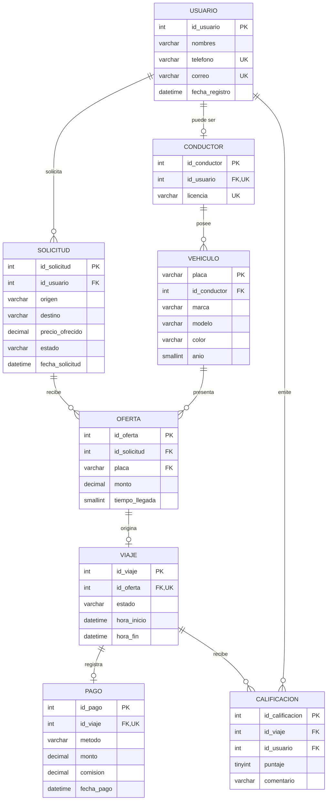
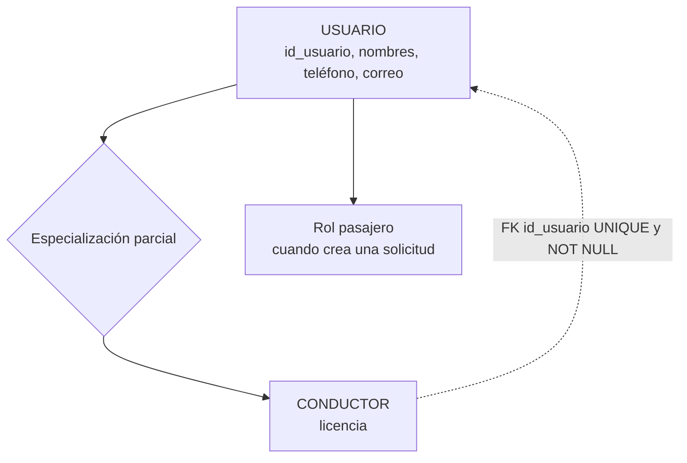

# Modelo entidad-relación y especialización EER

Fuente de verdad: [esquema SQL](../database/01-schema.sql). La notación indica cero, uno o muchos en cada extremo. PK identifica; FK referencia. El diagrama lógico no sustituye los CHECK ni los triggers.

Los pares (id_solicitud, placa) y (id_viaje, id_usuario) son únicos **en conjunto**, no por separado. Una oferta pertenece a una solicitud y vehículo; una solicitud y un vehículo pueden participar en muchas ofertas. Un viaje admite como máximo dos calificaciones por las reglas de participante y unicidad, aunque la FK aislada solo expresa 0..N. La aceptación de como máximo una oferta por solicitud depende del bloqueo y los triggers, no solo de la unicidad de id_oferta.

## EER: perfil de conductor

La especialización es **parcial**: puede haber usuarios sin perfil de conductor. Cada conductor corresponde a exactamente un usuario, y un usuario tiene como máximo un perfil de conductor. Pasajero es un rol en Solicitud, no otro subtipo implementado; un conductor también puede solicitar viajes. Al haber un solo subtipo representado, no corresponde imponer una disyunción entre subtipos ni inventar una especialización total. El esquema conserva id_conductor como PK y usa id_usuario como FK única para implementar la especialización.
